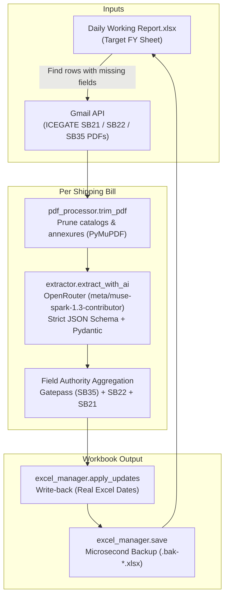

# Daily Report Sync

A robust, local Python CLI tool that automates filling missing customs clearance data in `Daily Working Report.xlsx` directly in place.

It reads shipping bills from Excel, searches ICEGATE emails in Gmail, extracts authoritative shipment data using OpenRouter AI (`meta/muse-spark-1.3-contributor`) with strict JSON schema validation, and writes verified updates back into Excel with automatic timestamped backups.

---

## Features

- **In-Place Excel Updates**: Fills missing fields directly in `Daily Working Report.xlsx` without breaking formulas or formatting.
- **Pure AI Extraction**: Extracts data via OpenRouter using structured JSON schemas and Pydantic validation (zero fragile regex fallbacks).
- **Intelligent PDF Page Pruning**: Discards Part III item catalogs, drawback claims, and non-movement annexures with PyMuPDF, reducing document tokens by 80–90%.
- **Concurrent Processing**: Multi-threaded Gmail fetching and AI extraction (`--workers`, default 3) with thread-safe credentials management.
- **Cancelled Bill Detection**: Automatically identifies cancelled shipping bills, stamps them as `Cancelled`, and skips redundant API calls.
- **Cell Merging & Empty Value Handling**: Seamlessly handles merged cells (e.g. LCL containers) and case-insensitive empty values (`na`, `n/a`, `-`).
- **Automated Backups**: Creates microsecond-precision `.bak-<YYYYMMDD-HHMMSS-ffffff>.xlsx` backups before modifying workbooks (auto-prunes to newest 5).
- **Read-Only Verification Auditing**: Built-in `--verify-rows` command compares fresh extractions against filled Excel rows to validate accuracy.

---

## Architecture & Pipeline



### Field Authority Rules

| Field | Primary Source | Extraction Rules |
| :--- | :--- | :--- |
| **Shipper Name** | SB21 &rarr; SB22 &rarr; Gatepass (`4.CHA`) | Exporter entity name only. Never the CHA company or `3.Exporter` block. |
| **Invoice No** | SB21 &rarr; SB22 (`2.INV NO.`) | Primary invoice token (e.g. `NF/156/2025-26`, `132/2026`). Inapplicable on Gatepass. |
| **LEO Date** | Gatepass order date &rarr; SB22 (`6.LEO Date` / `9.LEO`) | Stored as a native Excel date (`datetime.date`). Inapplicable on SB21. |
| **Containers** | Gatepass `Allowed for Movement` | Container IDs (e.g. `TCKU7809338`). Multi-values joined by `\n`. |
| **Container Sizes**| Gatepass `Allowed for Movement` | ISO container sizes (`20`, `40`, `45`). Multi-values joined by `\n`. |
| **Customs Seals** | Gatepass `Allowed for Movement` | Seal numbers between container and size columns. Multi-values joined by `\n`. |
| **Status** | Computed row outcome | Stamped in `Status` column: `Success`, `Partial`, `Cancelled`, or `Not found`. |

---

## Setup & Prerequisites

### 1. Requirements
- Python 3.14+
- [`uv`](https://docs.astral.sh/uv/) package manager

### 2. Install Dependencies
```bash
uv sync
cp .env.example .env
```

### 3. OpenRouter API Key (Required)
1. Sign up at [openrouter.ai](https://openrouter.ai).
2. Generate an API key at [openrouter.ai/keys](https://openrouter.ai/keys).
3. Add the key to `.env`:
   ```env
   OPENROUTER_API_KEY=sk-or-v1-...
   ```

### 4. Gmail API Setup (Required for Full Sync)
1. In [Google Cloud Console](https://console.cloud.google.com/apis/credentials), create a project and enable the **Gmail API**.
2. Under **OAuth consent screen**, select **External** and add your Gmail account as a test user.
3. Under **Credentials**, create an **OAuth client ID** of type **Desktop app**.
4. Download the client secret JSON and save it as `credentials.json` in the project root.
5. On the first run, the tool will open a browser window for one-time consent, caching the refresh token in `token.json`.

---

## CLI Usage

Run the sync CLI using `uv run --no-sync sync.py` (or install the entry point `daily-report-sync`):

```bash
# Audit missing fields across Excel workbook without modifying anything
uv run --no-sync sync.py --check

# Audit a specific financial year sheet
uv run --no-sync sync.py --check --sheet "FY 2024-25"

# Full automated synchronization (Gmail search -> PDF prune -> AI extract -> Excel write)
uv run --no-sync sync.py

# Sync a specific financial year sheet
uv run --no-sync sync.py --sheet "FY 2025-26"

# Sync only a single 7-digit Shipping Bill number
uv run --no-sync sync.py --sb 1278254

# Sync specific Excel rows by index or range
uv run --no-sync sync.py --rows 1349-1351
uv run --no-sync sync.py --rows 102,105,110

# Read-only audit: re-extract rows from Gmail and diff vs already filled Excel rows
uv run --no-sync sync.py --verify-rows 2-20 --sheet "FY 2024-25"

# Adjust concurrency worker threads (default 3, max 8)
uv run --no-sync sync.py --workers 4

# Force overwrite existing non-empty values
uv run --no-sync sync.py --force
```

### CLI Reference Options

| Option | Flag | Description | Default |
| :--- | :--- | :--- | :--- |
| Workbook Path | `--file <path>` | Path to the Excel workbook | `Daily Working Report.xlsx` |
| Sheet Name | `--sheet <str>` | Target sheet name in the workbook | `FY 2026-27` |
| Audit Mode | `--check` | Read-only scan of missing fields | `False` |
| Filter Shipping Bill | `--sb <str>` | Filter for a single 7-digit SB number | `None` |
| Specific Rows | `--rows <spec>` | Comma-separated or ranged Excel rows (`1349-1351`) | `None` |
| Verify Diff | `--verify-rows <spec>`| Read-only audit diffing fresh extraction vs filled Excel | `None` |
| Concurrency | `--workers <int>`| Number of worker threads (capped at 8) | `3` |
| Force Overwrite | `--force` | Overwrites non-empty cells | `False` |

---

## Testing & Quality Gates

Run the automated test suite and linter:

```bash
# Run all unit tests (42 unit tests, zero external dependencies)
uv run --no-sync pytest -q

# Run linter
uv run --no-sync ruff check src/ tests/ sync.py
```

---

## Troubleshooting

| Issue | Resolution |
| :--- | :--- |
| `Excel file not found` | Verify workbook exists in root or configure `EXCEL_PATH` in `.env` / pass `--file`. |
| `OPENROUTER_API_KEY is missing or empty` | Add your API key to `.env` (`OPENROUTER_API_KEY=sk-or-v1-...`). |
| Gmail OAuth consent fails | Delete `token.json` and re-run to trigger the browser authorization flow. |
| `No matching ICEGATE emails found` | Verify the 7-digit SB number exists and matching emails are present in Gmail. |
| Network timeout / Rate limit | Built-in exponential backoff automatically retries transient 429/500 errors up to 3 times. |

---

## License

This project is licensed under the [MIT License](LICENSE).
